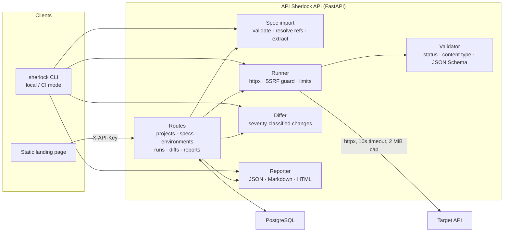

# API Sherlock

Find exactly what changed when an API integration breaks.

API Sherlock imports an OpenAPI specification, runs real requests against a live
API, validates every response against the contract, and reports the exact field
that broke — before your users find out.

> Status: **Phases 1–5 complete.** Spec import, environments, safe request runs,
> contract validation, baselines, spec/live diffs, JSON/Markdown/HTML reports, a
> CI-ready CLI, API-key protection, CORS and the versioned demo API are in place.

## What it does

- Import an OpenAPI 3.0 / 3.1 document as a JSON/YAML **file upload** or from a
  **URL**, validate it with clear JSON-path errors, resolve local `$ref`s and
  list every operation with its request/response contract.
- Manage per-project environments (base URL plus auth type) without ever storing
  credentials on the environment record.
- Run the operations that can be inferred from the spec using parameter
  examples/defaults and per-run bearer, API-key-header or basic credentials.
  Operations needing an uninferable parameter or request body are skipped with a
  plain reason.
- Validate response status, content type and JSON body against the declared
  schema; record exact violation paths, latency and concise auth hints for
  401/403 responses.
- Save a run's inferred response shapes as a named baseline — field names,
  types, nullability and array shape, never response values.
- Compare two specs, or a live run against a baseline, with exact JSON paths and
  breaking / warning / non-breaking severity.
- Report a run as JSON, Markdown or HTML with severity counts, a change table,
  failed operations and latency statistics.
- Gate CI on contract drift with `sherlock check`, which runs without the server
  or database.

This is one workflow, not a Postman competitor: no collections, mock servers,
request editor, scheduled monitoring or team workspaces yet.

## Architecture



The server and the CLI share the same services. The CLI path has no database: it
imports a local spec, runs requests, compares against a baseline JSON file and
renders the report in memory.

## Stack

FastAPI · Pydantic v2 · SQLAlchemy 2 + Alembic · PostgreSQL · httpx ·
jsonschema (Draft 2020-12) · openapi-spec-validator · Typer · pytest + respx ·
Docker

## Quick start (Docker)

```bash
API_KEY=local-dev-key docker compose up --build
```

The API container runs `alembic upgrade head` on boot. Everything except
`GET /health` requires the `X-API-Key` header, including `/docs` and
`/openapi.json`.

```bash
curl -s http://localhost:8000/health
curl -s -H "X-API-Key: local-dev-key" http://localhost:8000/projects
# OpenAPI document:
curl -s -H "X-API-Key: local-dev-key" http://localhost:8000/openapi.json > openapi.json
```

### Import a spec over HTTP

```bash
curl -s -X POST http://localhost:8000/projects \
  -H 'X-API-Key: local-dev-key' \
  -H 'content-type: application/json' \
  -d '{"name": "Payments"}'

curl -s -X POST "http://localhost:8000/projects/<project_id>/specs" \
  -H 'X-API-Key: local-dev-key' \
  -F file=@openapi.yaml

# or import from a public URL
curl -s -X POST "http://localhost:8000/projects/<project_id>/specs" \
  -H 'X-API-Key: local-dev-key' \
  -H 'content-type: application/json' \
  -d '{"url": "https://example.com/openapi.json", "version_label": "v1"}'
```

## 2-minute demo (CLI, no database)

Terminal 1 — the demo API in its spec-matching version:

```bash
python -m venv .venv
# Windows: .venv/Scripts/activate
source .venv/bin/activate
pip install -e ".[dev]"
DEMO_API_VERSION=v1 uvicorn demo_api.main:app --port 8001
```

Terminal 2 — baseline the healthy API, then check a broken deploy:

```bash
export SHERLOCK_TOKEN=demo-token

# 1. Baseline the healthy API (writes shapes, not values)
sherlock baseline save --spec demo_api/openapi.yaml --base-url http://127.0.0.1:8001 \
  --auth-type bearer --allow-private-hosts --output baseline.json

# 2. Start the broken version on another port
DEMO_API_VERSION=v2-breaking uvicorn demo_api.main:app --port 8002 &

# 3. Check it: exits 1 and names every breaking change
sherlock check --spec demo_api/openapi.yaml --base-url http://127.0.0.1:8002 \
  --auth-type bearer --allow-private-hosts --baseline baseline.json \
  --fail-on breaking --format markdown --output report.md

cat report.md
```

Expected: exit code `1` and exactly these changes — `name` removed and `active`
changed from boolean to string on `/users/{user_id}` and on `/users` items, plus
`GET /account` losing its 200 response and gaining a 401 (the demo switched that
route from Bearer to API-key auth). Pointing the same command at the v1 API exits
`0` with zero changes.

The same workflow runs over HTTP: create a project, import the spec, create an
environment, `POST /runs`, `POST /runs/{id}/baseline`, run again and
`GET /runs/{id}/diff?baseline_id=...`.

## Severity rules

Severities are consumer-centric: what a client would experience.

| Area | Change | Severity |
|---|---|---|
| Response | Field removed | Breaking |
| Response | Field type changed | Breaking |
| Response | Field made nullable | Breaking |
| Response | Required property removed (field remains) | Breaking |
| Response | Enum value removed | Breaking |
| Response | Status code removed or changed | Breaking |
| Response | Content type changed | Breaking |
| Response | Array item type changed | Breaking |
| Response | New enum value (clients may not handle it) | Warning |
| Response | Format changed (for example date to date-time) | Warning |
| Response | Numeric/length/array range changed | Warning |
| Response | New optional field added | Non-breaking |
| Response | Description changed | Non-breaking |
| Request | New required parameter or request field | Breaking |
| Request | Parameter removed | Warning |
| Request | New optional parameter | Non-breaking |

Every change carries its exact path, for example:

```
GET /users/{id} -> 200 -> body.address.zip: type changed from string to integer.
```

## API reference

All routes except `GET /health` require `X-API-Key`. Errors are JSON:
`{"error": {"code": "...", "message": "..."}}`; validation errors add `details`
with JSON paths.

| Method | Path | Purpose |
|---|---|---|
| GET | `/health` | Liveness (public) |
| POST | `/projects` | Create a project |
| GET | `/projects` | List projects |
| POST | `/projects/{id}/specs` | Import a spec (multipart `file`, or JSON `url` and `version_label`) |
| GET | `/projects/{id}/specs` | List specs and their extracted operations |
| POST | `/projects/{id}/environments` | Create an environment (base URL, auth type) |
| GET | `/projects/{id}/environments` | List environments |
| GET/PATCH/DELETE | `/projects/{id}/environments/{environment_id}` | Inspect, update, delete |
| POST | `/runs` | Run operations (`spec_id`, `environment_id`, optional `include_operations`, `parameter_values`, `auth`) |
| GET | `/runs/{id}` | Full run with per-operation results |
| POST | `/runs/{id}/baseline` | Save observed response shapes (`{"label": "v1"}`) |
| GET | `/projects/{id}/baselines` | List baseline metadata |
| GET | `/runs/{id}/diff?baseline_id=...` | Compare a run against a baseline |
| POST | `/projects/{id}/diff/specs` | Compare two specs (`old_spec_id`, `new_spec_id`) |
| GET | `/runs/{id}/report` | Report (query: `format=json, markdown, html`; optional `baseline_id`) |

Reports use the newest baseline saved **before** the run unless `baseline_id` is
given, so a report never compares against a baseline created later. Markdown and
HTML responses are downloadable documents.

### CLI

```bash
pip install .
sherlock baseline save --spec openapi.yaml --base-url https://api.example.com \
  --output baseline.json
sherlock check --spec openapi.yaml --base-url https://api.example.com \
  --baseline baseline.json --fail-on breaking --format markdown --output report.md
```

Exit codes: `0` clean, `1` changes at or above `--fail-on`, `2` tool or
configuration error. `--fail-on` accepts `breaking` (default), `warning` or
`non_breaking`; `--format` accepts `markdown` (default), `json` or `html`.

Secrets come from the environment only — never flags, reports or logs:

| Variable | Used for |
|---|---|
| `SHERLOCK_AUTH_TYPE` | `none` (default), `bearer`, `api_key_header`, `basic` |
| `SHERLOCK_TOKEN` | Bearer token |
| `SHERLOCK_API_KEY` | API key value |
| `SHERLOCK_AUTH_HEADER` | API key header name (default `X-API-Key`) |
| `SHERLOCK_USERNAME`, `SHERLOCK_PASSWORD` | Basic auth |

`--allow-private-hosts` is the CLI equivalent of `ALLOW_PRIVATE_HOSTS=true` and
is only for trusted local development.

### GitHub Actions

Copy [examples/github-actions.yml](examples/github-actions.yml) to
`.github/workflows/api-contract.yml`. It installs the package, runs
`sherlock check --fail-on breaking` on pull requests, writes the Markdown report
to `$GITHUB_STEP_SUMMARY`, uploads it as an artifact, and fails the job when a
breaking change is found. Set the `API_BASE_URL` repository variable and the
credential as a secret (`API_TOKEN` for bearer).

## Demo API

`demo_api/` is a small FastAPI target with four endpoints (`/health`,
`/users/{user_id}`, `/users`, bearer-protected `/account`) and a matching OpenAPI
spec. `DEMO_API_VERSION` switches behaviour per request:

- `v1` — matches the spec.
- `v2-safe` — adds an optional `plan` field (non-breaking).
- `v2-breaking` — removes `name`, changes `active` to a string, and moves
  `/account` from Bearer auth to an API-key header (`DEMO_API_KEY_HEADER`,
  default `X-Demo-Key`; value from `DEMO_API_KEY`, default `demo-key`).

The demo credentials are for local development only.

## Configuration

All configuration comes from environment variables (see `.env.example`):

| Variable | Default | Purpose |
|---|---|---|
| `DATABASE_URL` | Postgres on localhost | SQLAlchemy URL (SQLite only for tests) |
| `API_KEY` | `change-me` | Required in `X-API-Key` on every route except `/health` |
| `CORS_ORIGINS` | localhost:5173 | Comma-separated origins allowed to call the API |
| `ALLOW_PRIVATE_HOSTS` | `false` | Permit loopback/private targets; local development only |
| `REQUEST_TIMEOUT_SECONDS` | `10` | Outgoing request timeout |
| `MAX_RESPONSE_BYTES` | `2097152` | 2 MiB response cap |
| `MAX_SPEC_BYTES` | `5242880` | 5 MiB spec upload/URL cap |

## Repository layout

```
app/api        routers
app/core       config, API-key/SSRF security, errors
app/db         models, session, Alembic base
app/services   spec_import, runner, validator, differ, reporter
app/cli.py     Typer CLI (local/CI mode, no server or database)
tests/         pytest suite
demo_api/      versioned sample target API
examples/      GitHub Actions workflow for the CLI
alembic/       migrations
Dockerfile, docker-compose.yml
```

## Security notes

- **API key:** every route except `GET /health` requires `X-API-Key`, compared in
  constant time. Missing or wrong keys return `401 unauthorized`; an empty
  configured key returns `503 configuration_error` instead of serving traffic.
  CORS preflight requests are answered separately.
- **CORS:** origins come from `CORS_ORIGINS`; credentials are not allowed and only
  the methods the API uses are advertised.
- **SSRF:** target URLs are resolved with DNS before connecting, and every
  resolved IP is rejected if it is loopback, private, link-local, multicast,
  unspecified or the cloud-metadata address. Every redirect hop is re-checked and
  cross-origin redirects are refused. `ALLOW_PRIVATE_HOSTS=true` disables this for
  local development only.
- **Secrets are never stored.** Run credentials exist only in memory for the
  duration of a request, and baselines store inferred shapes rather than response
  bodies.
- **Data in logs:** runs log only method, path, status and latency — never
  credentials or response bodies.
- **Limits:** 10 second outgoing timeout, 2 MiB response cap, 5 MiB spec cap and a
  maximum of 5 redirects.

## Limitations (what it does not do yet)

- No collections, mock servers, request editor, scheduled monitoring or team
  workspaces — this is one testing workflow, not a full API client.
- Diffs compare response and request **shapes**; because bodies are not stored,
  value-level changes are out of scope.
- External `$ref` targets (other files or URLs) are rejected — inline them or
  import one self-contained document. Local `$ref` cycles stay as references.
- Authentication support covers none, bearer, API-key header and basic. OAuth2 and
  OIDC token flows are not executed.
- Operations that require a request body or cannot infer their required
  parameters are skipped, not generated.
- The CLI is on-demand only; it does not schedule runs or comment on pull requests
  by itself (the provided workflow posts the report to the job summary).

## Local development (no Docker)

```bash
python -m venv .venv
# Windows: .venv/Scripts/activate
source .venv/bin/activate
pip install -e ".[dev]"
cp .env.example .env             # point DATABASE_URL at your Postgres
alembic upgrade head
uvicorn app.main:app --reload
```

Set `API_KEY` in `.env` (the default `change-me` is a placeholder) and send
`X-API-Key` with every request except `/health`.

## Tests and lint

```bash
pytest                        # unit, API, CLI and end-to-end tests (SQLite)
ruff check .                  # lint
ruff format --check .         # formatting
```
